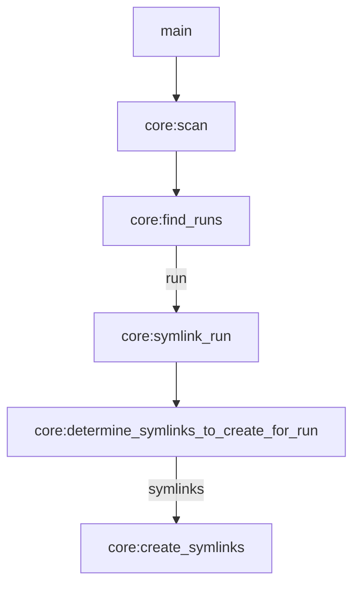

[](https://github.com/BCCDC-PHL/auto-fastq-symlink/actions/workflows/unit_tests.yml)
[](https://github.com/BCCDC-PHL/auto-fastq-symlink/actions/workflows/integration_tests.yml)

# auto-fastq-symlink
Automated symlinking of Illumina and Oxford Nanopore fastq files, organized by project.

## Configuration

The config file is `.json` format with the following structure:

```json
{
    "run_parent_dirs": [
        "/path/to/sequencers/M00123/runs",
        "/path/to/sequencers/M00456/runs",
        "/path/to/sequencers/VH00123/runs"
    ],
    "projects_definition_file": "/path/to/projects.csv",
    "scan_interval_seconds": 2,
    "fastq_extensions": [
        ".fastq",
        ".fastq.gz",
        ".fq",
        ".fq.gz"
    ]
}
```

A template with all of the config settings is in [`config_template.json`](config_template.json). The `project_id_translation_file` and `excluded_runs_list` settings are optional (see [Project ID Translation](#project-id-translation) and [Global Excluded Runs](#global-excluded-runs)), and can be removed if they aren't needed. If they're set, the files they refer to must exist, or the application won't start.

Each of the `run_parent_dirs` will be scanned for sequencing run output directories.
Illumina MiSeq, NextSeq and MiSeq i100, and Oxford Nanopore GridION and PromethION output directories are supported. The instrument type is determined from the format of the run output directory name (the run ID):

| Instrument | Run ID format                                 | Example                                   |
|------------|-----------------------------------------------|-------------------------------------------|
| MiSeq      | `\d{6}_M\d{5}_\d+_\d{9}-[A-Z0-9]{5}`          | `220602_M00123_0300_000000000-Q5539`      |
| NextSeq    | `\d{6}_VH\d{5}_\d+_[A-Z0-9]{9}`                | `220602_VH00123_12_AAAAAAAAA`             |
| MiSeq i100 | `\d{8}_SH\d{5}_\d+_[A-Z0-9]{10}-[A-Z0-9]{3}`   | `20250602_SH01234_0012_ASC2140000-SC3`    |
| GridION    | `\d{8}_\d{4}_X\d_[A-Z0-9]{8}_[a-z0-9]{8}$`      | `20261015_1336_X2_FBG78506_b2f5b6a3`      |
| PromethION | `\d{8}_\d{4}_P2S_\d+-\w_[A-Z0-9]{8}_[a-z0-9]{8}$` | `20260828_1544_P2S_00020-A_PAU96455_44eda675` |

The `projects_definition_file` is a `.csv` file with the following fields:

- `project_id`
- `fastq_symlinks_dir`
- `excluded_runs_list`
- `excluded_libraries_list`
- `simplify_symlink_filenames`

```csv
project_id,fastq_symlinks_dir,excluded_runs_list,excluded_libraries_list,simplify_symlink_filenames
routine_testing,/path/to/routine_testing/fastq_symlinks_by_run,/path/to/routine_testing_excluded_runs.csv,/path/to/routine_testing_excluded_libraries.csv,True
assay_development,/path/to/assay_development/fastq_symlinks_by_run,/path/to/assay_development_excluded_runs.csv,/pat/to/assay_development_excluded_libraries.csv,False
```

Both the `excluded_runs_list` and the `excluded_libraries_list` are simple plaintext files with a single column and no header. Each line is an identifier for a run or a library, respectively, which will be excluded from symlinking for that project.

```csv
sample-01
badsample
sample-238
```

```csv
220803_M00123_0314_000000000-AGH1C
220822_M00456_0218_000000000-A65GM
```

If the value for the `simplify_symlink_filenames` field is set to `True` (or one of these: `true`, `T`, `t` or `1`), then the symlinks will be renamed to include only the library ID, followed by `_R1.fastq.gz` or `_R2.fastq.gz` (Illumina), or `_RL.fastq.gz` (Oxford Nanopore, where 'RL' means long reads). This feature is useful when symlinking to the fastq files that the sequencers produce, which include additional run-specific tags in the filename (like: `mylibrary_S23_L001_R1_001.fastq.gz`, or `mylibrary_barcode01_RL.fastq.gz`). If the `simplify_symlink_filenames` field is set to `False` (or one of these: `false`, `F`, `f` or `0`), then the filenames of the symlinks will match the filenames of the target files.

### Global Excluded Runs

Runs can also be excluded for all projects, by adding an optional `"excluded_runs_list"` entry to the config file:

```json
{
    "run_parent_dirs": [
        "/path/to/sequencers/M00123/runs"
    ],
    "projects_definition_file": "/path/to/projects.csv",
    "excluded_runs_list": "/path/to/excluded_runs.csv",
    "scan_interval_seconds": 2,
    "fastq_extensions": [
        ".fastq.gz"
    ]
}
```

The global excluded runs list has the same format as the per-project `excluded_runs_list` files: one run ID per line, with no header. Excluded runs aren't scanned at all: their run directories aren't read, so no symlinks are created for them for any project, and no errors are logged for them. This can be used to silence a run directory that is broken or unreadable. Changes to the list take effect on the next scan. Excluding a run doesn't remove any symlinks that were already created for it.

Like the per-project exclusion lists, if the global excluded runs list is set in the config but can't be loaded, the application won't start (or, if it's already running, it will continue with the last valid config).

### Project ID Translation

It may be the case that we don't want to use the exact project IDs that were provided in the SampleSheet files, or we want to translate a set of SampleSheet project IDs into a single project for symlinking.
If that is the case, an optional config entry can be added under the key `"project_id_translation_file"`, as shown below.

```json
{
    "run_parent_dirs": [
        "/path/to/sequencers/M00123/runs",
        "/path/to/sequencers/M00456/runs",
        "/path/to/sequencers/VH00123/runs"
    ],
    "projects_definition_file": "/path/to/projects.csv",
    "project_id_translation_file": "/path/to/project_id_translation.csv",
    "scan_interval_seconds": 2,
    "fastq_extensions": [
        ".fastq",
        ".fastq.gz",
        ".fq",
        ".fq.gz"
    ]
}
```
The `project_id_translation.csv` file should be a csv-formatted file with the headers:

- `samplesheet_project_id`
- `symlinking_project_id`

For example, the following file will translate both `14` and `r_and_d` into `research_and_development`. It will translate `28` into `outbreak_investigation`.

```csv
samplesheet_project_id,symlinking_project_id
14,research_and_development
r_and_d,research_and_development
28,outbreak_investigation
```

**Note:** The `symlinking_project_id` should appear in the `project_id` field of the `projects_definition_file`.

## Application Flowchart

The application keeps no state of its own between scans. Everything it needs is read from the config files and the filesystem on each scan.

The application cycles between two phases:

1. **Load config**

The config file is loaded, then the `project_definition_file` listed in the config file is loaded, then the exclusion lists that are listed in the project definition file are also loaded.

The config is re-loaded before every scan, so changes (including changes to the exclusion lists) take effect without restarting. If the config (or any file it refers to) can't be loaded when the application starts, it exits with an error. If it can't be re-loaded later, a `load_config_failed` error is logged and the application continues with the last valid config.

2. **Find and symlink runs**

Look through all of the `run_parent_dirs` listed in the config file, and find any sub-directories that match one of the supported run ID formats. A run is ready to be symlinked once:

- it has an `upload_complete.json` file,
- it has a `qc_check_complete.json` file, with an `overall_pass_fail` value of `PASS`, and
- for Oxford Nanopore runs, it has a `combine_fastq_complete.json` file (its contents aren't checked).

When a run that is ready is found:

	1. Determine which type of instrument the run was generated by (MiSeq, NextSeq, MiSeq i100, GridION or PromethION), and find the output of the latest demultiplexing of the run.
	2. Find and parse the SampleSheet for the latest demultiplexing to determine which libraries are on the run, and which project each library belongs to.
	3. For each project that has libraries on the run, check whether the project already has a symlinks directory for the run (`<fastq_symlinks_dir>/<run_id>`). If it does, leave it alone.
	4. Otherwise, create the symlinks directory for the run.

A problem with one run (for example, a file that can't be read) is logged, and doesn't stop other runs from being symlinked. The run will be tried again on the next scan. Likewise, a run parent dir that can't be read is logged and skipped for that scan.

Each scan starts `scan_interval_seconds` (from the config) after the previous scan started, or immediately if the previous scan took longer than that. If `scan_interval_seconds` isn't set in the config, the `--scan-interval` command-line option is used (default: 10 seconds).

If the application receives `SIGINT` (via `Ctrl-c`) or `SIGTERM`, it will wait for a safe time before exiting (in between runs, or while waiting for the next scan). A second signal stops it immediately.



### Latest Demultiplexing

A run may be demultiplexed more than once. Symlinks always point to the fastq files from the latest demultiplexing, and the SampleSheet from that demultiplexing is used to determine which libraries belong to which project.

| Run directory structure | Latest demultiplexing                                                            | SampleSheet                                           |
|-------------------------|----------------------------------------------------------------------------------|-------------------------------------------------------|
| MiSeq (old)             | `Data/Intensities/BaseCalls`                                                     | `SampleSheet*.csv` at the top level of the run directory |
| MiSeq (new)             | `Alignment_<N>/<timestamp>/Fastq`, with the highest `N` and the latest timestamp | `Alignment_<N>/<timestamp>/SampleSheetUsed.csv`       |
| NextSeq                 | `Analysis/<N>/Data/fastq`, with the highest `N`                                  | `Analysis/<N>/Data/SampleSheet*.csv`                  |
| MiSeq i100              | `Analysis/<N>/Data/BCLConvert/fastq`, with the highest `N`                       | `Analysis/<N>/inputs/SampleSheet*.csv`                |
| GridION / PromethION    | `fastq_pass_combined`                                                            | `sample_sheet_<flow_cell_id>_<date>_<time>_<run_hash>.csv` at the top level of the run directory (see below) |

Only the SampleSheet for the latest demultiplexing is used. There is no fall-back to the SampleSheet at the top level of the run directory (except for the old MiSeq directory structure, which only supports one demultiplexing), because it may not match the latest demultiplexing. If the SampleSheet can't be found, a `samplesheet_not_found` error is logged, and the run is tried again on the next scan.

If there are several SampleSheets in a directory, the one named exactly `SampleSheet.csv` is used. If there isn't one, but there is only one SampleSheet, that one is used.

MiSeq i100 SampleSheets use the same format as NextSeq SampleSheets. Libraries and their projects are read from the `Sample_ID` and `ProjectName` fields of the `[Cloud_Data]` section.

### Oxford Nanopore Runs

Oxford Nanopore (GridION and PromethION) runs aren't demultiplexed more than once. After a run is uploaded, the fastq files for each sample are combined into a single file in the `fastq_pass_combined` directory, and a `combine_fastq_complete.json` file is written to the top level of the run directory.

The sample sheet's name is generated from the run ID. For run `20261015_1336_X2_FBG78506_b2f5b6a3`, it's `sample_sheet_FBG78506_20261015_1336_b2f5b6a3.csv`. If there isn't a sample sheet with that name, but there is exactly one file named like `sample_sheet*.csv` at the top level of the run directory, that one is used, and a `using_samplesheet_with_unexpected_name` warning is logged. If there are several, the run isn't symlinked, and a `multiple_samplesheets_found` error is logged.

The sample ID and project ID for each sample are combined in the `alias` field of the sample sheet, as `<sample_id>_<project_id>`. The alias is split on the first underscore, so project IDs may include underscores (eg. `cpo_production`), but sample IDs can't. The fastq file for each sample is `fastq_pass_combined/<sample_id>_<barcode>_RL.fastq.gz`, using the `barcode` field of the sample sheet (eg. `barcode01`).

### Re-generating Symlinks

Once a project's symlinks directory for a run has been created, it is never modified, even if the run is later re-demultiplexed. To re-generate the symlinks for a run (for example, after a new demultiplexing), delete or move the run's symlinks directory. It will be re-created on the next scan, pointing to the fastq files from the latest demultiplexing.

Wait until the new demultiplexing is complete before deleting the symlinks directory. Otherwise the symlinks may be created from an incomplete set of fastq files.

Each symlinks directory is built under a temporary name (`.<run_id>.tmp`) and renamed into place once all of its symlinks have been created. The `symlinks_complete.json` file is only written after the rename, so it never appears in the temporary directory. Downstream systems can treat the presence of `<run_id>/symlinks_complete.json` as the signal that the directory is ready.

If the application is interrupted before the rename, the temporary directory is removed and re-built on the next scan. If it is interrupted in the brief moment after the rename but before `symlinks_complete.json` is written, the directory is left without that file and a `run_symlinks_dir_missing_symlinks_complete` warning is logged on each scan. Delete the directory to re-generate it.

Only one instance of the application should run against a given set of `fastq_symlinks_dir`s at a time. Concurrent instances aren't guarded against, and could interfere with each other's temporary directories.

## Logging

Logs are written in [JSON Lines](https://jsonlines.org/) format, one log entry per line:

```json
{"timestamp": "2026-10-21T14:58:10.982", "level": "INFO", "module": "core", "function_name": "symlink_run", "line_num": 553, "message": {"event_type": "symlink_run_complete", "sequencing_run_id": "220602_M00123_300_000000000-Q5539", "total_num_symlinks_created": 12, "num_symlinks_created_by_project_id": {"routine_testing": 12}}}
```

Unexpected errors also include an `exception` field with the traceback.

By default, logs are written to stdout. The following command-line options control logging:

| Option                       | Description                                                                                                                       |
|------------------------------|-----------------------------------------------------------------------------------------------------------------------------------|
| `--log-level`                | `debug`, `info` (default), `warning` or `error`                                                                                    |
| `--log-file`                 | Append logs to this file instead of stdout. The file is rotated at midnight, and rotated files are named with the date they cover (eg. `auto-fastq-symlink.jsonl.2026-10-21`) |
| `--log-retention-days`       | Number of rotated log files to keep (default: 90). `0` keeps all of them                                                           |

## Testing

Unit tests can be run from the top-level of the source directory as follows:

```
python -m unittest -vv
```

Integration testing can be performed by simulating sequencing runs using [dfornika/illumina-run-simulator](https://github.com/dfornika/illumina-run-simulator). That tool can be configured to simulate realistic `SampleSheet.csv` files and directory structures for both NextSeq and MiSeq files. It can be configured to simulate new runs on a frequent basis (every 5 seconds for example). If the `auto-fastq-symlinker` tool is configured to look at the directories where the `illumina-run-simulator` is writing its output, then it should be able to create symlinks for those simulated runs as they are being simulated.
